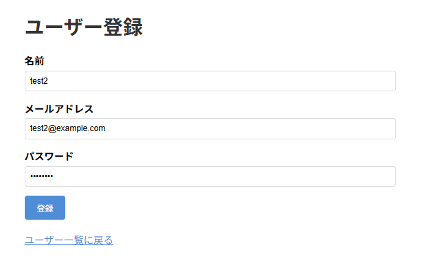
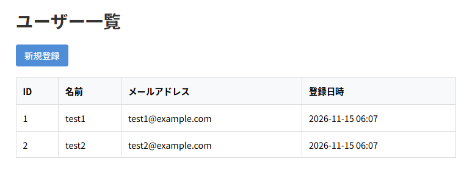

# debugging-app-practice

## 概要
COACHTECH 教材 Tutorial 10-4「デバッグ ハンズオン演習」で作成した成果物です。
エラーメッセージを確認してバグの原因を特定し、プログラムのバグを修正して正常に動作するようにしました。

## 使用技術
- PHP 8.5.12
- Laravel 10.50.0
- デバッグツール（`dd()`, `dump()`, `Log` ファサード）

## 学んだこと
- エラーメッセージからバグがある箇所と原因を特定するための読み解き方
- dd() やログを活用したデバッグの進め方
- マスアサインメントエラーに対して、$fillable の設定によりエラーを解決するプロセス

## 動作確認
1. スターターキットをcloneする
2. debugging-app-practiceディレクトリ上でsail up -dコマンドによりyamlファイルに記述した構成通りのコンテナを起動させてネットワークで連携
3. sail artisan migrateコマンドによりテーブルを作成
4. ブラウザで「`http://localhost/users/create`」のURLにアクセスしてユーザー登録を行う
5. 「`http://localhost/users`」に自動で遷移し、ユーザー一覧に作成したユーザーが表示されていることを確認

## 教材の書き方との違いによる学び
- 自分でコードを修正する時はエラーメッセージを読んで原因の箇所を修正して正常に動作することを確認しただけだが、教材の工程ではdd()による変数の中身の確認やコントローラーでの\Log::infoを利用したログの取得、さらにコントローラーではなくミドルウェアを作成し、コントローラー実行前後に\Log::infoによってログを取得してKernelの$middlewareAliasesに登録、ルートにミドルウェアを適用するというプロセスの説明があった
┗ミドルウェアでHTTPライフサイクルのログを残すことで、本番環境でもよりエラーの原因を特定しやすい仕組みを実現することができる

## 動作確認のスクリーンショット
1. ユーザー登録フォーム画面

   

2. ユーザー一覧画面

   
